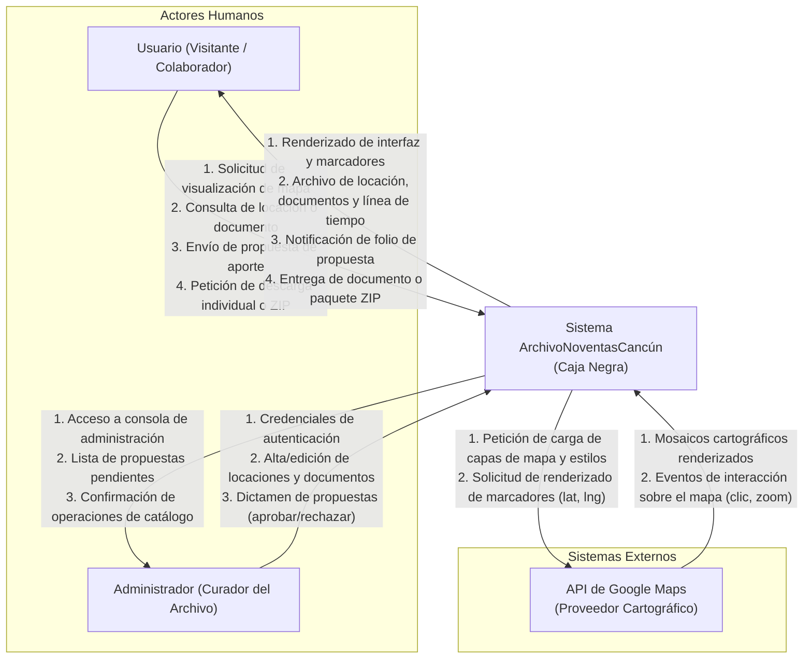

# Sección 2: Contexto y Actores

## 2.1 Situación Actual y Cambio Propuesto
Actualmente, el rescate de la memoria fotográfica y documental de Cancún ocurre de forma fragmentada en redes sociales, repositorios fotográficos sin catalogación sistemática o álbumes familiares inaccesibles al público general. Las plataformas cartográficas comerciales existentes (como Google Maps) priorizan establecimientos comerciales activos, opiniones mercantiles y rutas viales, omitiendo la dimensión histórica y evolutiva de los espacios urbanos. Aquellas personas o investigadores que poseen documentos relevantes no disponen de un canal formal ni georreferenciado para contribuir con sus registros. **ArchivoNoventasCancún** transforma esta situación proporcionando una plataforma web interactiva donde el territorio urbano de Cancún se reinterpreta como un circuito histórico digital: cada punto en el mapa despliega su memoria documental en orden cronológico, y cualquier usuario puede proponer material fotográfico y documental para ser curado y publicado por administradores del archivo.

---

## 2.2 Diagrama de Contexto del Sistema

---

## 2.3 Tabla de Actores y Sistemas Externos

| Actor / Sistema Externo | Tipo | Qué hace en el sistema | Información que envía al sistema | Información que recibe del sistema | Comportamiento si no responde / falla |
| :--- | :--- | :--- | :--- | :--- | :--- |
| **Usuario (Visitante)** | Persona (Humano) | Explora el mapa, consulta el archivo y los documentos de cada locación, visualiza líneas del tiempo, descarga documentos individuales o el archivo completo en ZIP, y envía propuestas ciudadanas de aporte. | Términos de búsqueda, selección de locaciones/documentos, datos de formulario de propuesta (archivo binario, metadatos, contacto opcional). | Vistas del mapa, archivo de la locación, previsualizaciones de documentos, paquetes ZIP de descarga, folio de confirmación de propuesta. | N/A (Es el cliente emisor). |
| **Administrador** | Persona (Humano) | Autentica su sesión, crea y actualiza locaciones, publica documentos con sus metadatos oficiales, y revisa el buzón de propuestas para aprobarlas o rechazarlas. | Credenciales de acceso (usuario y contraseña), formularios de alta de locación (nombre, coordenadas, reseña), documentos validados, dictámenes de moderación. | Tablero de control administrativo, cola de propuestas con estado actual, confirmaciones de guardado o errores de validación. | N/A (Es el operador administrativo). |
| **Google Maps JavaScript API** | Sistema Externo | Provee el motor cartográfico, mosaicos de satélite/mapa urbano, estilos visuales y la capa interactiva sobre la cual se proyectan los marcadores geográficos. | Mosaicos de mapa generados, eventos de interacción en el canvas (clic en coordenadas, cambio de nivel de zoom). | Clave de API (*API Key*), coordenadas base de Cancún, configuraciones de estilo gráfico, coordenadas de marcadores de locaciones. | **Política de degradación:** Si la API no responde, agota su cuota de peticiones o devuelve error de red, el sistema oculta el contenedor del mapa y despliega un banner de contingencia con una **vista alternativa en catálogo/tabla cronológica**. Esta vista permite a los usuarios continuar buscando locaciones, visualizando expedientes y descargando archivos sin interrumpir la operación principal. |
